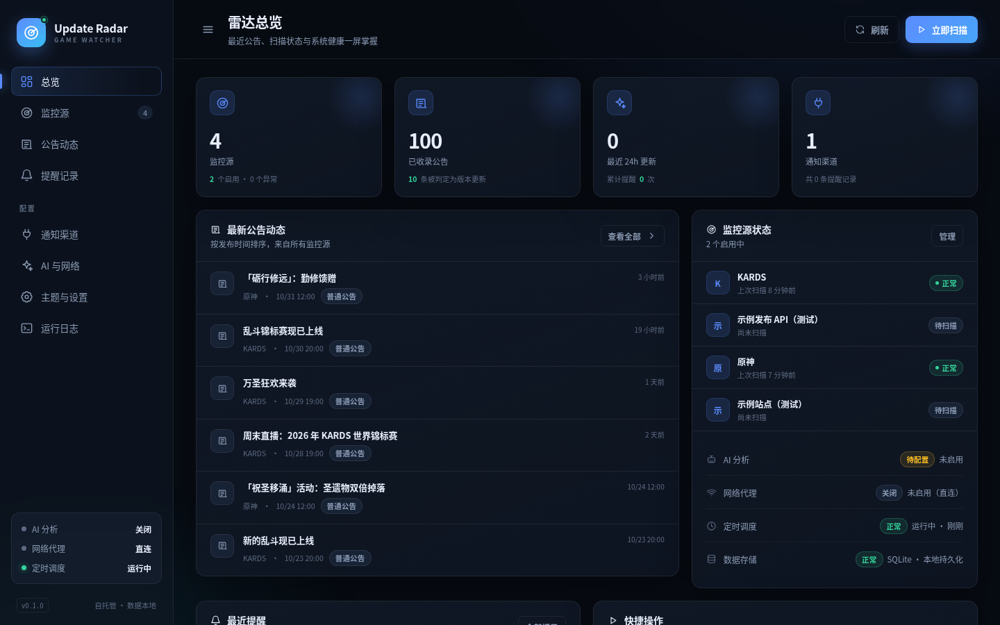
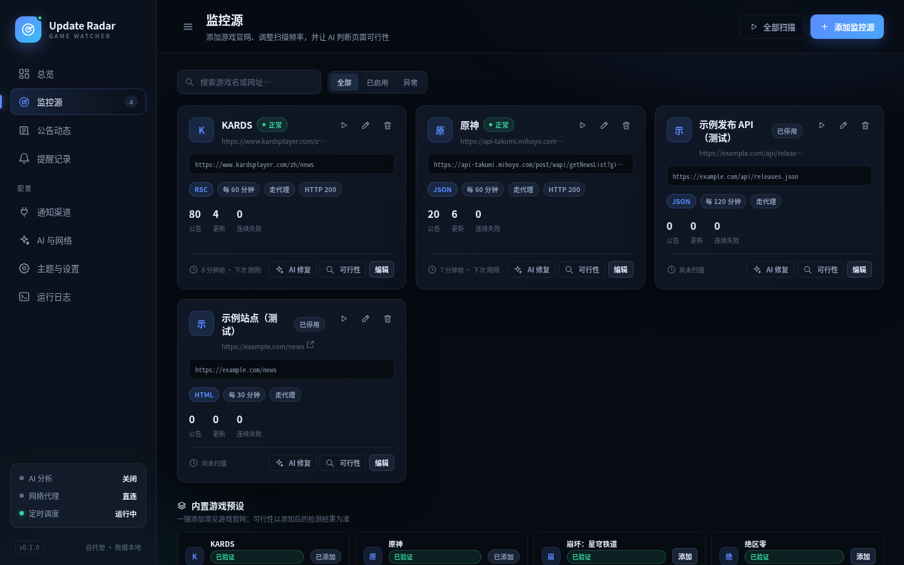

# Game Update Radar

自托管的「游戏更新雷达」：定时抓取游戏官网新闻/公告，用规则 + AI 判断是否为新版本更新，再通过邮件、短信、Telegram、Webhook、Bark、Server酱、PushPlus、ntfy 等渠道提醒你「该更新游戏了」。

- 应用单容器 + 可选 Browserless 渲染 sidecar；默认端口 **3155**，`network_mode: bridge`
- 数据全部落在宿主机 `./data`（容器内 `/config`）
- 原生 WebUI，无 CDN、无前端构建步骤，离线可用
- 支持 DeepSeek / OpenAI 兼容 / Anthropic / Ollama 等 AI 接口
- 支持 HTTP/HTTPS 代理，可对单个站点关闭代理
- 内置 7 套主题，可自定义强调色、背景、卡片、文字、圆角与密度
- 支持添加任意游戏官网，并让 AI 检测该页面是否适合抓取
- 支持 Browserless 无头浏览器渲染，JS 壳站点可自动降级渲染
- 内置 KARDS、米哈游、鸣潮、明日方舟、蔚蓝档案等已验证官方 API 预设

## 界面预览





## 快速开始

```bash
git clone <your-repo> game-update-radar
cd game-update-radar

# 可选：修改宿主机端口（默认 3155）
cp .env.example .env

docker compose up -d --build
docker compose logs -f radar
```

打开 <http://localhost:3155>。

首次启动会自动创建数据库、加密密钥，并内置一个 **KARDS** 监控源（`https://www.kardsplayer.com/zh/news`，RSC 解析策略）。默认只启动 `radar`，**不会拉取约 1GB 的 Chromium 镜像**。进入「监控源」点一次「扫描」建立基线；基线不会给历史公告发提醒。之后每 60 分钟自动扫描，发现新公告才通知。

需要浏览器渲染 JS 壳站点时，再显式启用 profile：

```bash
docker compose --profile browser up -d --build
```

第一次拉取 Browserless 仍可能较慢，见下面的「加快镜像拉取」。

更新代码后：

```bash
docker compose up -d --build
```

日常只是启动/重启，不需要 `--build`，也不会重新拉镜像：

```bash
docker compose up -d
```

### 加快镜像拉取与构建

首次慢通常分两类：拉基础镜像/Chromium，和从 PyPI 装依赖。默认不拉 Chromium；如果仍慢，按下面处理。

1）只启动应用（最快，不需要浏览器）：

```bash
docker compose up -d --build
```

2）需要浏览器时再拉 Browserless：

```bash
# 只拉 browser，不重建 radar
docker compose --profile browser pull browser

# 启动应用 + 浏览器
docker compose --profile browser up -d
```

3）国内镜像代理（可选，先确认地址可访问）：

```bash
# .env
PYTHON_IMAGE=docker.m.daocloud.io/library/python:3.12-slim
BROWSER_IMAGE=ghcr.m.daocloud.io/browserless/chromium:latest
```

`PYTHON_IMAGE` 用于 `FROM`，`BROWSER_IMAGE` 用于 Browserless；换成你自己的加速器地址即可。Docker Desktop / Linux 也可以给 Docker daemon 配 `registry-mirrors`（只加速 Docker Hub，不加速 ghcr.io）。

4）构建依赖镜像：

国内网络建议在 `.env` 里启用就近 PyPI 镜像后重建：

```bash
# .env
PIP_INDEX_URL=https://pypi.tuna.tsinghua.edu.cn/simple
```

```bash
docker compose build --progress=plain
docker compose up -d
```

说明：

- 只改 `app/`、`web/` 时，依赖层会命中缓存，通常几秒完成。
- `browser` 服务默认不参与 `docker compose up`，避免每次启动都检查/拉取 1GB 镜像。
- 重复启动不会重复拉取 Browserless（`pull_policy: missing`）；要更新浏览器镜像时手动 `docker compose --profile browser pull browser`。
- `RUN --mount=type=cache` 需要 BuildKit（Docker 23+ / Compose v2 默认开启）。
- 如果镜像源不可用，删掉 `PIP_INDEX_URL` 或换回 `https://pypi.org/simple`。
- 仍慢时用 `--progress=plain` 看卡在哪一层，而不是盲目重试。

停止/备份：

```bash
docker compose down
tar czf radar-backup-$(date +%F).tar.gz data/
```

## 目录结构

```
app/                FastAPI 后端、扫描器、通知器、调度器
web/                原生 WebUI（index.html / style.css / app.js）
tests/              pytest
data/               本地数据（SQLite、加密密钥、日志），已 gitignore
Dockerfile
docker-compose.yml
```

## 核心配置

### 1. AI 接口

WebUI →「AI 与网络」→ 填写：

| 项目 | 示例 |
| --- | --- |
| 服务商 | DeepSeek |
| Base URL | `https://api.deepseek.com/v1` |
| 模型 | `deepseek-chat` |
| API Key | `sk-...` |

保存后点「测试 AI」。Key 使用 Fernet 加密后存入 `/config/radar.db`，接口返回时脱敏，不会写进日志。AI 未配置或不启用时，规则判定仍然完整工作。

### 1.1 AI 自动修复/创建抓取策略

页面能打开、但通用提取器识别到 **0 条公告** 时，若 AI 已启用且打开「自动修复抓取策略」，系统会进入修复流程：把页面可见文本、清洗后的 HTML 结构、链接样本、脚本地址和候选接口（截断）交给模型，要求它输出**声明式策略**（HTML CSS 选择器、JSON 接口 + 字段路径、或 RSC 链接片段）；链接写在 `data-href`/`data-url` 等属性时也能识别。

每个候选都会先由服务端**真实抓取并提取验证**，满足“至少 1 条、标题/链接有效、不是导航文字”才保存；最多尝试 3 次（可配 1–5），失败不会覆盖原策略。成功后会写入源配置并立即排队一次真实扫描，基线/增量逻辑保持不变。失败会记录 `scan.repair` 日志，并按冷却时间（默认 360 分钟）跳过后续自动尝试，避免反复消耗 AI 额度。

- WebUI：监控源卡片的 **AI 修复** 按钮可手动强制触发；「AI 与网络」可调整尝试次数、失败冷却和自动开关。
- 安全边界：AI 只能提交受控的选择器/URL/Header，不会执行 Python/JavaScript；候选接口不能指向与源站不同的内网/本机地址，不跟随登录态，也不处理验证码。
- 能力边界：扫描时会先尝试 Browserless 渲染；若渲染后仍无公告、且站点没有任何公开 JSON/RSS，AI 会返回 `action=cannot`，不会伪造成功。此时应改用官方 API/RSS，或检查站点是否需要登录/验证码。
- 浏览器渲染还会校验 Browserless 返回的最终 URL 必须与监控源同主机（允许 `www.` 差异），避免把登录页/错误页当成公告。
- API：`POST /api/sources/{id}/repair`，返回 `ok`、`items_found`、`attempts` 和 `message`。


也支持：

- OpenAI 兼容：`https://api.openai.com/v1` 或任意中转地址
- Anthropic：Base URL `https://api.anthropic.com/v1`，模型如 `claude-3-5-haiku-latest`
- Ollama：`http://host.docker.internal:11434`（Linux 下可改为宿主机网关地址），模型如 `qwen2.5:7b`

> 容器内 `127.0.0.1` 指向容器自身。Ollama 跑在宿主机时，Windows/macOS 用 `host.docker.internal`；Linux 可在 compose 加 `extra_hosts: ["host.docker.internal:host-gateway"]`。

### 2. 网络代理

WebUI →「AI 与网络」→「网络代理」：

- 开关：启用后，抓取、AI 请求、HTTP 通知、代理测试都走代理
- HTTP 代理：如 `http://192.168.1.2:7890`
- HTTPS 代理：如 `http://192.168.1.2:7890`（多数代理 HTTP/HTTPS 共用一个端口）
- no_proxy：`localhost,127.0.0.1`
- 测试地址：默认 `https://api.ipify.org?format=json`，应返回代理出口 IP

每个监控源还有「走代理」开关，可对国内站点单独关闭。HTTP 通知和 AI 请求复用同一代理；**SMTP 是裸 TCP 协议，不经过 HTTP 代理**，如需在受限网络中发邮件，请使用内网 SMTP 中继。

### 2.1 浏览器渲染（Browserless）

很多游戏官网是纯前端 SPA，普通 HTTP 抓取只能拿到空壳。`docker-compose.yml` 内置了 Browserless Chromium sidecar：

- 与 `radar` 共享网络命名空间（`network_mode: "service:radar"`），应用通过 `http://127.0.0.1:3000/content` 调用，不额外暴露端口。
- 抓取到 0 条公告时，若「AI 与网络 → 浏览器渲染」开启，系统会自动渲染页面并重新提取；成功后在源卡片显示「浏览器」标记。
- 只对 `auto` / `html` / `rsc` 策略启用；`json` / `api` 直连接口优先，不会多跑一次浏览器。
- 可在「AI 与网络」里关闭自动渲染、修改 Browserless 地址、Token、等待时间和超时。
- Browserless 自身的出网代理与应用内的代理设置是两套：容器访问外网需要代理时，在 `docker-compose.yml` 的 `browser.environment` 里设置 `HTTP_PROXY` / `HTTPS_PROXY`；应用页面的代理只作用于应用发起的 HTTP/AI/通知请求。
- 资源占用：Chromium 常驻约 300–600MB 内存；小内存机器可在 `docker-compose.yml` 里给 `browser` 加 `mem_limit: 768m`，或把 `CONCURRENT` 调到 1。

### 3. 通知渠道

新增渠道时先在「渠道类型」下拉选择类型（默认邮件 SMTP），表单字段会随类型切换；保存后可直接点「测试」验证。

| 类型 | 必填字段 | 说明 |
| --- | --- | --- |
| 邮件 SMTP | SMTP 服务器、发件地址、收件地址 | 支持 starttls / ssl / none；多个收件人用逗号分隔 |
| Telegram | Bot Token、Chat ID | 通过 `api.telegram.org` 发送 |
| Webhook | URL | POST JSON，可自定义 Header 和请求体模板 |
| Bark | Device Key | 默认 `https://api.day.app` |
| Server酱 | SendKey | `https://sctapi.ftqq.com/<key>.send` |
| PushPlus | Token | 微信推送 |
| ntfy | Topic | 默认 `https://ntfy.sh`，可自建 |
| Twilio SMS | Account SID、Auth Token、From、To | 国际短信，按 Twilio 计费 |
| Console | 无 | 写入运行日志，适合本地验证 |

每个渠道都能单独启停、发送测试消息。提醒发送失败自动重试 2 次；仍失败会记录在「提醒记录」，可手动重发，不会影响其它渠道。

Webhook 默认 payload：

```json
{
  "event": "game_update",
  "game": "KARDS",
  "title": "KARDS 更新 - 2026 年 10 月",
  "summary": "……",
  "url": "https://www.kardsplayer.com/zh/news/...",
  "published_at": "2026-10-15T03:36:05+00:00",
  "message": "【KARDS】检测到新的更新公告……"
}
```

### 4. 添加游戏官网

「监控源」→「添加监控源」：

1. 填游戏名和新闻列表 URL
2. 抓取策略建议先选 `auto`
3. 点「检测可行性」，系统抓取样本、识别条目、给出策略和建议；启用 AI 后会额外让模型判断页面结构
4. 保存后点「扫描」建立基线

策略说明：

- `auto`：依次尝试 JSON / RSC / HTML
- `html`：普通服务端渲染列表
- `rsc`：Next.js `self.__next_f.push` 流式数据（KARDS 使用）
- `json` / `api`：直接请求返回 JSON 的接口，可在「高级」里填接口地址

首次扫描只入库不提醒；之后只对「新的 `external_id`」做判定。默认只提醒 45 天内发布的公告，避免首次接入时补推旧闻。

## KARDS 实测结论

- 页面：<https://www.kardsplayer.com/zh/news>
- 站点是 Next.js（Vercel），HTML 里几乎没有公告 DOM，列表藏在 RSC payload 中
- 当前实现解析 `self.__next_f.push` 中的 `href/title/date/summary`
- 实测抓取 80 条，标题、日期、绝对链接均正确；最新公告为「服务器停机维护预告」
- 首次基线不提醒；删除一条已见记录后重扫，成功生成 1 条提醒并投递到 Console 渠道

## 原神 / 崩坏：星穹铁道等可行性

官方新闻页本身仍是 Nuxt/JS 壳（`ys.mihoyo.com/main/news`、`sr.mihoyo.com/main/news`），直接用网页抓取会返回 0 条，可行性检测会如实给出 `needs_browser: true`。因此内置预设改为调用米哈游公开内容 API：

| 游戏 | 预设数据源 | 实测结果 |
| --- | --- | --- |
| 原神 | `api-takumi.mihoyo.com/post/wapi/getNewsList?gids=2&page_size=20&type=1` | ✅ HTTP 200，20 条，日期/标题正确，链接指向米游社 `ys/article/{post_id}` |
| 崩坏：星穹铁道 | 同上 `gids=6` | ✅ HTTP 200，20 条，链接指向 `sr/article/{post_id}` |
| 绝区零 | 同上 `gids=8` | ✅ HTTP 200，20 条，链接指向 `zzz/article/{post_id}` |

预设的 `selectors` 已内置 `items_path=data.list` 与 `url_template`，安装后无需手填。API 返回的是「官方新闻/活动」列表，活动公告不一定每次都判为版本更新；真正的版本更新/补丁公告仍会按关键词与 AI 复核命中。

### 已验证的官方 JSON 接口

| 游戏 | 预设数据源 | 实测结果 |
| --- | --- | --- |
| 鸣潮 | 库洛 `ArticleMenu.json` | ✅ 191 条，链接指向 `mc.kurogames.com/main/news/detail/{articleId}` |
| 明日方舟 | `ak.hypergryph.com/api/news?page=1` | ✅ 6 条，`cid` 保留前导零，链接 `ak.hypergryph.com/news/{cid}` |
| 蔚蓝档案（国服） | `bluearchive-cn.com/api/news/list` | ✅ 10 条，链接 `bluearchive-cn.com/news/{id}` |
| 碧蓝档案（GameKee 公告） | `www.gamekee.com/ba/notice` → `/v1/content/pageList` | ✅ 20 条，带 `game-alias: ba` 头，链接 `www.gamekee.com/ba/{id}.html` |
| 米哈游系 | 米哈游内容 API | ✅ 原神/星穹铁道/绝区零各 20 条 |

安装预设后会直接使用 JSON 策略，无需再点「检测可行性」。`auto` 策略遇到 0 条时会先尝试 Browserless 渲染，仍失败才会让 AI 生成新策略。

碧蓝航线、重返未来 1999、Nikke 的官网目前是 SPA、404 或拒绝直连；内置预设保留为 `auto`，添加后可通过浏览器渲染或 AI 修复实际检测，**不要把未验证预设当成成功**。

## 主题自定义

「主题与设置」提供 7 套预设：深空蓝、极光紫、森林绿、日落橙、玫瑰红、深海青、浅色日间。

可直接修改：

- 强调色 / 辅助色
- 页面背景 / 卡片表面 / 主文字
- 明暗模式
- 界面密度（紧凑 / 标准 / 宽松）
- 圆角 0–24px

保存后写入服务端设置，刷新和换设备仍保留。所有颜色只通过 CSS 变量注入，不使用 `innerHTML` 拼接站点文本。

## API 摘要

交互式文档：<http://localhost:3155/api/docs>

| 方法 | 路径 | 用途 |
| --- | --- | --- |
| GET | `/api/health` | 健康检查 |
| GET | `/api/summary` | 总览数据 |
| GET/POST | `/api/sources` | 列出/新增监控源 |
| PUT/DELETE | `/api/sources/{id}` | 修改/删除 |
| POST | `/api/sources/{id}/scan` | 立即扫描 |
| POST | `/api/sources/{id}/probe` | 检测该源可行性（含浏览器降级） |
| POST | `/api/sources/{id}/repair` | 让 AI 生成并验证新抓取策略 |
| POST | `/api/scan-all` | 扫描全部启用源 |
| GET | `/api/items` | 公告列表 |
| GET | `/api/alerts` | 提醒记录 |
| POST | `/api/alerts/{id}/resend` | 重发提醒 |
| GET/POST | `/api/channels` | 通知渠道 |
| POST | `/api/channels/{id}/test` | 测试渠道 |
| GET | `/api/settings` | 全部设置（密钥脱敏） |
| PUT | `/api/settings/{group}` | 保存设置 |
| POST | `/api/ai/test` | 测试 AI |
| POST | `/api/feasibility` | 检测任意 URL |
| POST | `/api/proxy/test` | 测试代理 |
| POST | `/api/browser/test` | 测试 Browserless 渲染 |
| GET | `/api/presets` | 内置预设 |
| GET/DELETE | `/api/logs` | 运行日志 |

## 排障

**页面打不开 / 容器不停重启**

```bash
docker compose logs --tail=100 radar
docker compose ps
curl http://localhost:3155/api/health
```

**扫描返回 error**

到「运行日志」看 `scan.error`，常见原因：代理未启用、目标站 403/Cloudflare、策略不对。先用「检测可行性」确认页面是否服务端渲染。

**AI 自动修复没有生效**

先确认「AI 与网络」里 AI 已启用、Key 可测试通过，且「自动修复抓取策略」打开。只有“页面抓取成功但提取 0 条”才会触发；HTTP 403/超时不会触发。看「运行日志」的 `scan.repair`：失败会记录每次尝试的错误和冷却时间。若源卡片有「浏览器」标记但仍无公告，说明页面需要登录/验证码或接口需要额外参数，应改用官方 API/RSS。

**浏览器渲染没有生效**

```bash
docker compose --profile browser ps browser
docker compose --profile browser logs --tail=100 browser
```

确认 `browser` 容器处于 running，且「AI 与网络 → 浏览器渲染」已开启、地址为 `http://127.0.0.1:3000`。首次运行需要拉取 Chromium 镜像；国内网络可给 browser 配置镜像加速或 `HTTPS_PROXY`。

**AI 测试失败**

检查 Base URL 是否包含 `/v1`、模型名、Key 余额；如果启用了代理，确认代理能访问 AI 域名。错误 Key 只返回可读错误，不会崩溃或清空规则判定。

**邮件收不到**

先用「测试渠道」。QQ 邮箱等需要使用「授权码」而不是登录密码；587 端口一般选 starttls，465 选 ssl。检查垃圾箱和发件人白名单。

**调度不触发**

「监控源」应处于启用状态，`next_run_at` 应显示下一次时间。改系统时区后建议重启容器；修改扫描间隔会在 30 秒内自动重排。

**端口被占用**

改 `.env` 中 `RADAR_PORT=13155`，然后 `docker compose up -d`，访问 `http://localhost:13155`。

## 安全说明

首版没有登录鉴权，默认监听 `0.0.0.0:3155`。请勿直接暴露到公网；建议：

- 只映射到内网：`127.0.0.1:3155:3155`
- 或放在 Nginx/Caddy 反向代理 + Basic Auth / SSO 后面
- 定期备份 `data/`，其中 `secret.key` 用于解密 API Key 和邮箱密码

## 开发

```bash
uv venv .venv
uv pip install -r requirements.txt
.venv/bin/python -m pytest -q
CONFIG_DIR=./data .venv/bin/uvicorn app.main:app --port 3155
```

无 Docker 环境时也可直接运行；生产推荐 compose。前端修改 `web/` 后刷新即可，无需构建。
